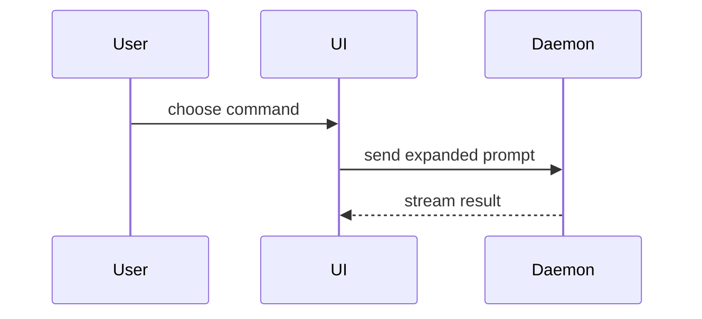

# File Pull Request
Before filing, check whether a PR for this branch already exists. Use the base branch specified by the user or calling workflow; otherwise use the existing PR's base, or the repository's default branch for a new PR. Review the diff locally against that base to make sure its contents match the goal, and use the same base when creating the PR.

Before submission, check the title, description, quotes, and attachments for any confidential details or secrets, such as passwords, keys, etc. 

Open a real review, not just a draft, so that review bots run. If `gh pr create` fails because the GraphQL rate limits are used up, open it through the REST API with `gh api repos/owner/repo/pulls -f title=... -f head=... -f base=... -f body=@<file>`.

If the user has asked you to babysit it as well, continue with the `babysit-pr` skill.

Do not post a follow-up PR comment unless it serves the user's request. When a comment is needed, use the `leaving-pr-comments` skill. 

## Pull Request Title
PR titles usually become commit messages, so follow the repository's title conventions. Look at recently merged PRs and Git history for examples. Prefer a concise, human-readable title that explains why the change matters:

BAD:
```
> ❌ perf(server): negotiate permessage-deflate on the websocket
```

GOOD:
```
> ✅ perf(server): cut websocket frame size by 70%+ with gzipping
```

## Pull Request Body Template
Use the following template when posting the PR. Include all sections, intentionally note when a section is blank on purpose. Skip all preambles, and keep detail brief and dense. Use user's domain language from the repo's `GLOSSARY.md` or `GLOSSARY-MAP.md` files if present.

```markdown
# Summary
<a one or two line summary, diagrams, diff-sketch, tree, etc>

# Evidence
1. <A one-line summary of a scenario that was not working correctly.>
**Before**: <The screenshot or technical detail of what specifically was going wrong.>
**After**: <The screenshot or technical detail proving that the issue is now resolved.>

# Merge Danger
**Door**: <one-way or two-way. When helpful, include a brief description of the change which causes this designation, and things to be careful of before merging and deploying this PR.>

**Blast Radius**: 

# AI Notice
<which models were used in the generation of this PR.>
```

## Pull Request Template Guidance
### Summary
A one or two line summary of why this PR exists. What does it aim to achieve? Why should we care about this?

Include diagrams or logic views when appropriate. Pick the smallest view that makes the key points of the PR clear to a reviewer.

- Show logic or an algorithm as pseudocode:

```text
on(save)
  if content is unchanged
    return cached result
  write new content
  return fresh result
```

- Show runtime control flow as a call tree:

```text
submitForm
  createSession
    persistPrompt
    launchAgent
  navigateToSession
```

- Show UI structure as a component tree, including state and module boundaries that matter:

```text
<SessionPage> (apps/example/src/routes/session.tsx)
  useSessionEvents()
  <SessionToolbar>
    <RunSkillButton> (packages/ui)
```

- Show file responsibility or a broad refactor as a shallow file tree:

```text
src/
├── commands/       # parses user actions
├── sessions/       # owns session state
└── transport/      # sends API requests
```

- Show component interaction, control flow, or data flow with Mermaid:



- Use `diff` when the point is what changes and the surrounding shape already exists. Match the diff shape to the topic.

For a component change:

```diff
 <SessionPage>
   useSessionEvents()
   <SessionToolbar>
+    <RunSkillButton />
   <SessionTimeline>
+    <SkillResultCard />
```

For a file-layout change:

```diff
 src/
 ├── commands/
+│   └── show-me.ts       # expands the slash command
 ├── sessions/
-└── transport.ts
+└── transport/
+    ├── client.ts
+    └── stream.ts
```

For a call-tree or call-stack change:

```diff
 submitForm
   createSession
     persistPrompt
+    expandSkillMention
     launchAgent
-  navigateToSession
+  navigateToSession
+    subscribeToEvents
```

For a state or control-flow change:

```diff
 on(save)
-  write content
+  if content is unchanged
+    return cached result
+  write new content
+  invalidate cache
```

- Show the whole block when most of it is new, when omitted context would hide ownership or order, or when the user needs a copyable target shape:

```ts
function expandSkill(command: string): string {
  const skillName = command.slice(1);
  return `use the ${skillName} skill`;
}
```

### Evidence
A list of concrete evidence showing the change was implemented as a human would expect.
For bug fixes, this would include before and after proof showing the issue was real and is now resolved.
For new features, this would show the feature off and include proof that the expected scenarios are functioning normally.

Screenshots are S-tier when the environment is set up for it and the changes include visual details (such as UI changes).
Execution evidence is A-tier. Show the exact scenario that one failed and now passes using pseudocode, test results, console output of a command, or real code if the example is small enough.

### Merge Danger
Door: Describe whether this change is a "one way" or "two way" door. You can walk back through a two-way door, but not a one-way door. PRs that are cheap to roll back or which can be neutralized easily are low-risk (two-way). Changes that involve destructive actions or data migration are harder to reverse (one-way).

Blast Radius: The blast radius is the potential impact or scope impact introduced by this PR. Consider all possibilities. Examples include unexpected changes to UI layout, feature breakage for consumers, mobile responsiveness issues, performance degradation, impacts in a certain area of the application, etc. 

### AI Disclosure
In the pull request body, with the names of models and harnesses that made the changes. For example: `Created with <model> in <harness>.` If subagents were used, include the models that wrote parts of the change in subagents as well. Use the model name as the harness reports it. If model name identity is unavailable, name the harness without guessing what the model names were. Don't invent information just to provide something here, as false information is worse than no information at all. 